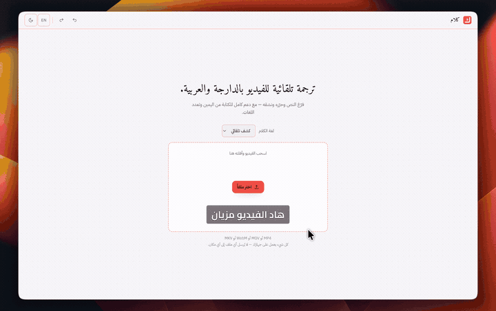

<p align="center">
  
</p>

<h1 align="center">Klam</h1>

<p align="center">
  <strong>Auto-captioning video editor for Arabic and Darija.</strong><br>
  Upload a clip, edit the captions, restyle them live, export a burned-in MP4.
</p>

<p align="center">
  <a href="LICENSE"></a>
  
  
  
</p>

<p align="center">
  
</p>

---

Arabic is the default case here, not a setting you hunt for: right-to-left
layout, correct joining and shaping, mixed Arabic/Latin/numeral runs, and
Darija ↔ French code-switching. The editor, the preview and the exported video
all run on your own machine — **nothing is uploaded anywhere**.

## Features

- **Transcribe** — speech to timed captions with VAD segmentation, chunking and
  word-level alignment, so captions follow the voice instead of a fixed rate
- **Edit** — split, merge, delete and retime segments against the playhead, with
  undo/redo
- **Style** — bundled Arabic fonts (Cairo, Tajawal, Noto Naskh Arabic, Amiri,
  IBM Plex Sans Arabic, Inter), colour, outline, shadow, background, position,
  RTL/LTR, and per-word highlight
- **Export** — burned-in MP4 (libass), SRT, VTT, ASS and project JSON, at
  source / 16:9 / 1:1 / 9:16

The live preview and the burned-in export are produced from the same caption
schema and the same font files, so what you see is what lands in the file.

## Requirements

Shared by every platform:

| | |
|---|---|
| **Python 3.12** and **`uv`** | Backend. |
| **Node** and **`pnpm`** | Frontend. |
| **FFmpeg** | Required even with no speech model — every job extracts audio. |
| **FFmpeg with libass** | Only for burned-in MP4 export. SRT, VTT, ASS and the whole editor work without it. |

Then pick a transcription backend. Everything else about the app is identical
whichever you choose, and you set it with `VOX_ASR_PROVIDER` in `backend/.env`
(copy `.env.example`) or the environment:

| Backend | Runs on | Notes |
|---|---|---|
| **`mlx`** *(default)* | macOS, Apple Silicon | Fastest on a Mac. The only backend that needs a conversion step. |
| **`local-gpu`** | Linux or Windows, NVIDIA GPU | torch + transformers in-process. **No conversion** — it downloads its models from the Hub on first run. Wants ~16–20 GB of VRAM for both models. |
| **`voxtral`** | Anything, including a CPU-only box | A remote OpenAI-compatible endpoint — see [`deploy/modal/`](deploy/modal/). Sends your audio off the machine. |
| **`mock`** | Anything | Fixed Arabic text and no model, for working on the editor. |

## Quickstart

### macOS on Apple Silicon

```bash
git clone https://github.com/Elma-dev/klam.git && cd klam

make setup            # Python venv + backend dependencies
make setup-mlx        # + the MLX speech dependencies
make model            # build the speech model — see below
make setup-frontend   # frontend dependencies
```

### Linux or Windows with an NVIDIA GPU

No conversion step, and MLX is not involved at all:

```bash
git clone https://github.com/Elma-dev/klam.git && cd klam

make setup            # Python venv + backend dependencies
make setup-frontend   # frontend dependencies

cd backend
uv pip install --python .venv/bin/python -e ".[local-gpu]"
cp ../.env.example .env      # then set VOX_ASR_PROVIDER=local-gpu
```

The first transcription pulls `mistralai/Voxtral-Mini-4B-Realtime-Arabic` and a
Whisper aligner from the Hub — several GB — after which it runs offline.

### Any machine, remote endpoint

With neither an Apple chip nor an NVIDIA GPU, run the models elsewhere and keep
the editor local: see [`deploy/modal/`](deploy/modal/), then set
`VOX_ASR_PROVIDER=voxtral` and `VOX_VOXTRAL_BASE_URL`.

> This **sends your audio off the machine**, so the upload screen's "nothing is
> uploaded anywhere" line no longer applies to your setup.

### Just the UI

```bash
make dev-all      # backend with the mock transcriber + the UI
```

Run whichever backend you configured, alongside the UI, in separate terminals:

```bash
make dev          # backend on http://localhost:8001
make frontend     # UI on http://localhost:5173
```

Open <http://localhost:5173>, drop in a clip, and caption it.

### The MLX speech model (macOS)

`make model` converts the public
[`mistralai/Voxtral-Mini-4B-Realtime-Arabic`](https://huggingface.co/mistralai/Voxtral-Mini-4B-Realtime-Arabic)
checkpoint into an 8-bit MLX model at `~/models/voxtral-ar-8bit`.

Budget for it: **about 20 GB of free disk** (the source repository ships ~18 GB
of weights; the result is ~4.7 GB) and **roughly 9–10 GB of RAM** at peak, so a
16 GB Mac will swap. Expect several minutes.

<details>
<summary><strong>Why a conversion, and not the Hub repo directly</strong></summary>

<br>

The Mistral repository is a *conversion source*, not a loadable model. It ships
its weights twice — once in Mistral's own `consolidated.safetensors` layout and
once in HuggingFace format — under two different key schemes. mlx-audio's generic
loader globs every `.safetensors` file and merges them, which produces garbage
after the model's `sanitize()` step. The converter knows this and reads only the
consolidated file, which is why it works and a direct load does not.

</details>

To use a model someone has already published, skip the conversion entirely and
point `VOX_MLX_MODEL` at a Hub repo id — the value may be either a local
directory or a repo id, and a repo id downloads on first use:

```bash
export VOX_MLX_MODEL=abdeljalilELmajjodi/voxtral-ar-8bit-mlx
```

The same applies to `VOX_ALIGNER_MODEL`, the Whisper model that supplies word
timings (it already defaults to a Hub repo id).

<details>
<summary><strong>Publishing the conversion (maintainers)</strong></summary>

<br>

```bash
hf auth login
make model MLX_HF_REPO=abdeljalilELmajjodi/voxtral-ar-8bit-mlx
```

</details>

## CLI

```bash
cd backend
.venv/bin/python -m vox_darija transcribe clip.mp4 --lang ar --format srt
.venv/bin/python -m vox_darija transcribe clip.mp4 --provider mock --format vtt
```

`--provider` takes `mlx`, `voxtral`, `local-gpu` or `mock`; `--format` takes
`srt`, `vtt` or `json`. Without `--output` it writes to stdout.

## Development

```bash
make test     # backend pytest + frontend vitest
make lint     # ruff + oxlint
make fmt      # ruff format
make doctor   # ffmpeg / libass / fonts
make fonts    # (re)fetch the bundled OFL fonts
```

Arabic correctness is tested rather than assumed — HarfBuzz shaping tests in the
backend assert joined forms and catch missing glyphs, and Skia golden-image tests
in the frontend compare rendered Arabic and mixed-script text against committed
references. Those are what stop a bidi or font regression from shipping quietly.

<details>
<summary><strong>Architecture</strong></summary>

<br>

```
frontend/   React + TypeScript + Vite + Tailwind + Zustand
  src/schema.ts        Zod mirror of the backend schema
  src/store.ts         Zustand store: segments, style, undo/redo, upload
  src/i18n.ts          Arabic and English UI strings
  src/direction.ts     Unicode bidi first-strong detection
  src/fonts.ts         bundled-font loader (@font-face) + custom fonts
  src/lib/             canvas rendering, snapping, platform presets
  src/components/      player, caption overlay, transcript, timeline, panels
  public/fonts/        bundled OFL fonts + their licence texts

backend/    Python 3.12 + FastAPI
  src/vox_darija/
    schema.py          caption + style schema, the single source of truth
    pipeline.py        media → audio → VAD → chunks → ASR → captions
    asr/               ASRProvider protocol; mlx, voxtral, local-gpu, mock
    aligners.py        Whisper word timings (the alignment reference track)
    wordmap.py         maps reference words onto the transcript we display
    model_ref.py       local directory or Hub repo id resolution
    audio/             FFmpeg extraction, VAD, chunking
    segmentation.py    caption line-breaking rules
    direction.py       Unicode bidi first-strong detection
    export/            ASS generator, SRT/VTT, libass burn-in
    ffmpeg.py          libass-capable FFmpeg auto-detection
    jobs.py            in-process asyncio queue + SQLite store
    main.py            FastAPI app: upload, jobs, assets, export, SSE
```

**How timing works.** Voxtral is the accurate Arabic transcriber but returns no
timestamps, while the caption modes that follow the voice need them. So a second
model — Whisper — decodes the same audio with word timestamps, and those
reference words are mapped onto Voxtral's transcript by sequence alignment. A
mediocre Whisper *transcript* therefore cannot corrupt the captions; it can only
make the timings more proportional. With no aligner available at all, timings
fall back to a proportional spread and the captions still render.

</details>

## Contributing

Contributions are welcome — see [CONTRIBUTING.md](CONTRIBUTING.md), and
[CODE_OF_CONDUCT.md](CODE_OF_CONDUCT.md) for the ground rules. Bugs that involve
Arabic shaping, bidi or word timing are much easier to fix with a short clip
attached.

## License

[Apache-2.0](LICENSE).

Bundled fonts are licensed under the SIL Open Font License 1.1, with their
licence texts alongside them in `frontend/public/fonts/licenses/`.
